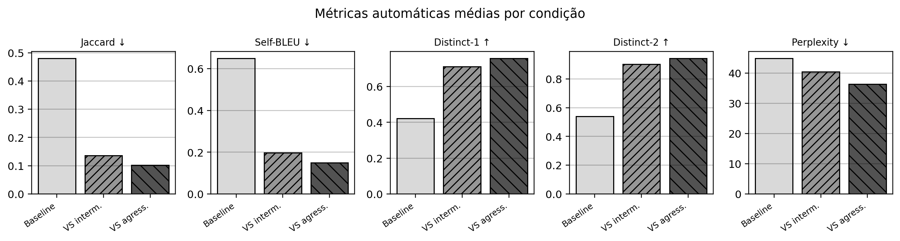
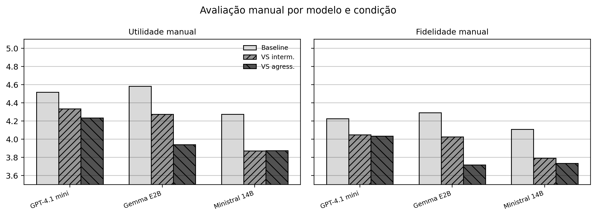

# Verbalized Sampling para rascunhos de mensagens

[**Relatório final**](output/doc/relatorio_tp1_nlp.pdf) · [Resultados e análise](results/final/resultados_finais/observações.md) · [Reproduzir](docs/reproducao.md) · [Prompts](data/prompts/)

**Pedir alternativas e suas probabilidades aumenta a diversidade sem prejudicar a utilidade das respostas?** Este projeto compara geração direta com duas variantes de Verbalized Sampling (VS) em mensagens cotidianas em português. O experimento usa três modelos, métricas automáticas e uma avaliação manual registrada, com prompts, parâmetros e respostas brutas preservados.

O trabalho foi desenvolvido por Matheus Henrique de Oliveira Garcia no TP1 de NLP da Universidade Federal do Amazonas. A técnica foi aplicada por engenharia de prompt, sem fine-tuning.

Esta é a versão pública para portfólio do [repositório original da disciplina](https://github.com/ed-icomp-ufam/trabalho-pr-tico-1-nlp-2026-01-mh131105), cujo acesso é restrito. O histórico de desenvolvimento, o relatório, o código e os resultados experimentais foram preservados.

## Resultados principais

Nas condições avaliadas, o **VS reduziu a repetição e aumentou a diversidade lexical nos três modelos**. As notas de utilidade e fidelidade, porém, ficaram abaixo do baseline. A variante agressiva produziu respostas mais diversas e também mais detalhes ausentes da mensagem original.

| Modelo | Condição | Self-BLEU ↓ | Distinct-2 ↑ | Utilidade / 5 | Fidelidade / 5 |
| --- | --- | ---: | ---: | ---: | ---: |
| GPT-4.1 mini | Baseline | 0,779 | 0,435 | 4,517 | 4,225 |
| GPT-4.1 mini | VS intermediário | 0,270 | 0,836 | 4,333 | 4,050 |
| GPT-4.1 mini | VS agressivo | 0,197 | 0,899 | 4,233 | 4,033 |
| Gemma E2B | Baseline | 0,808 | 0,402 | 4,583 | 4,292 |
| Gemma E2B | VS intermediário | 0,171 | 0,930 | 4,275 | 4,025 |
| Gemma E2B | VS agressivo | 0,134 | 0,963 | 3,942 | 3,717 |
| Ministral 14B | Baseline | 0,359 | 0,779 | 4,275 | 4,108 |
| Ministral 14B | VS intermediário | 0,151 | 0,941 | 3,871 | 3,793 |
| Ministral 14B | VS agressivo | 0,119 | 0,966 | 3,875 | 3,733 |

Self-BLEU mede repetição entre alternativas; valores menores indicam menor repetição. Distinct-2 mede variedade de bigramas; valores maiores indicam maior variedade lexical. As notas manuais seguem uma escala de 1 a 5. Valores arredondados a três casas a partir das [métricas automáticas](results/final/resultados_finais/metrics_summary.csv) e das [notas agregadas](results/final/resultados_finais/manual_metrics_summary.csv).

Cada combinação tem 24 grupos nas métricas de diversidade, exceto Ministral/VS intermediário, com 23 por uma falha de parse. As notas desse grupo abrangem 116 registros, incluindo a falha com nota 1; as demais combinações têm 120 registros cada.



A figura apresenta médias simples dos três modelos por condição. A perplexidade é uma medida auxiliar dependente do avaliador fixo, sem equivalência direta com utilidade ou correção.

O relatório interpreta o **VS intermediário como o compromisso mais equilibrado** entre diversidade e preservação da intenção. Essa interpretação não significa superioridade em cada modelo ou categoria. Em mensagens de intenção rígida, como recusas e agradecimentos, alternativas variadas por vezes mudaram o papel comunicativo da resposta. Algumas recusas, por exemplo, viraram adiamentos da decisão.



A [análise crítica](results/final/resultados_finais/observações.md) detalha erros e diferenças por categoria e formalidade. O [relatório](output/doc/relatorio_tp1_nlp.pdf) reúne método, resultados e discussão.

## Experimento e implementação

O dataset contém **24 mensagens**: três exemplos de cada categoria — pedido, cobrança, recusa, agradecimento, convite, esclarecimento, confirmação e adiamento. São 15 mensagens formais e nove informais. O pipeline compara:

- **Baseline:** cinco chamadas de geração direta por mensagem, com uma resposta em cada chamada.
- **VS intermediário:** uma chamada que solicita cinco alternativas e suas probabilidades declaradas.
- **VS agressivo:** uma chamada que solicita cinco alternativas com probabilidades declaradas abaixo de `0.10`.

As condições usam `temperature=0.6` e `top_p=0.95`. Os limites de saída são 220 tokens por chamada no baseline e 700 no VS. Os campos de formalidade e tons esperados ficam ocultos dos prompts e são usados na avaliação. O formato VS contém `tone`, `text` e `probability`; as probabilidades são estimativas verbalizadas, sem calibração demonstrada.

| Modelo no experimento | Backend | Identificador registrado |
| --- | --- | --- |
| GPT-4.1 mini | OpenAI API | `gpt-4.1-mini` |
| Gemma E2B | LM Studio local | `mlx-community/gemma-4-e2b-it` |
| Ministral 14B | LM Studio local | `ministral-3-14b-instruct-2512` |

A implementação em Python inclui validação do dataset, templates de prompt, clientes de LLM, parsing de JSON, tentativas de geração, métricas e exportação da avaliação manual. O [manifesto](results/final/resultados_finais/manifest.json) registra configuração, hash do dataset e ambiente.

Foram preservados **1.076 registros**: 1.075 com status `success` e uma falha de parse, que substituiu cinco alternativas esperadas por um registro de erro. As [respostas brutas](results/final/resultados_finais/raw_responses/), as [gerações](results/final/resultados_finais/generations.jsonl) e a [avaliação preenchida](results/final/resultados_finais/manual_eval_completed.csv) permitem inspecionar os resultados sem novas chamadas aos modelos.

## Caminho mínimo para reproduzir

Python 3.11 ou superior. Clone o projeto e prepare o ambiente:

```sh
git clone https://github.com/mh131105/verbalized-sampling.git
cd verbalized-sampling
python3 -m venv .venv
source .venv/bin/activate
python -m pip install -r requirements.txt
python scripts/validate_project.py --config configs/experiment.lmstudio.yaml
python -m pytest
```

A validação e os testes usam dados locais e clientes simulados, sem precisar de uma chave OpenAI ou do servidor LM Studio. Eles verificam o pipeline e não certificam os resultados experimentais.

Para gerar novas respostas, prepare os modelos locais no LM Studio e a credencial OpenAI conforme [reprodução](docs/reproducao.md). A geração consulta os backends configurados e pode consumir créditos da API.

```sh
python scripts/check_lmstudio.py --config configs/experiment.lmstudio.yaml
python scripts/run_experiment.py \
  --config configs/experiment.lmstudio.yaml \
  --run-id reproducao_vs
python scripts/compute_metrics.py \
  --config configs/experiment.lmstudio.yaml \
  --run-id reproducao_vs
python scripts/make_plots.py --run-id reproducao_vs
```

Esses comandos criam uma execução em `results/runs/reproducao_vs/`. A avaliação manual é uma etapa separada; as notas originais não são atribuídas às novas respostas. O [guia completo](docs/reproducao.md) reúne configuração, validação dos modelos, métricas e avaliação manual.

## Limitações

- O experimento usa 24 mensagens e uma execução registrada por modelo/configuração. Os resultados descrevem esse recorte, sem estabelecer uma melhoria geral de qualidade.
- A comparação mantém temperatura e top-p, mas também varia formato, instruções, número de chamadas e limite de saída. Não isola apenas o pedido de probabilidades.
- A avaliação manual foi feita por um avaliador, conforme o relatório. Não há estimativa de concordância entre avaliadores nem evidência de revisão cega independente.
- Métricas lexicais capturam repetição e variedade superficial; uma resposta diversa pode inventar contexto ou mudar a intenção. A perplexidade depende do avaliador fixo utilizado.
- O baseline não declara `tone`. Seu zero em `tone_diversity_ratio` não demonstra ausência real de diversidade de tom; essa métrica não permite comparação direta entre as condições.
- As probabilidades declaradas não foram calibradas. Cumprir o limiar de `0.10` não comprova amostragem da cauda de uma distribuição probabilística conhecida.
- Os nomes dos modelos e os parâmetros foram registrados, mas as revisões dos pesos e todas as escolhas de quantização dos modelos locais não foram fixadas no manifesto. Uma nova execução pode produzir respostas e métricas diferentes.

## Organização

| Caminho | Conteúdo |
| --- | --- |
| [`output/doc/`](output/doc/) | Relatório final em PDF/DOCX e figuras incorporadas. |
| [`results/final/resultados_finais/`](results/final/resultados_finais/) | Execução final, respostas brutas, métricas e avaliação registrada. |
| [`docs/reproducao.md`](docs/reproducao.md) | Instalação, execução, métricas e avaliação manual. |
| [`data/`](data/) e [`configs/`](configs/) | Dataset, prompts e configuração experimental. |
| [`src/tp1_nlp/`](src/tp1_nlp/) e [`scripts/`](scripts/) | Implementação modular e comandos do pipeline. |
| [`tests/`](tests/) | Testes de dataset, prompts, parsing, métricas e execução simulada. |

O [DOCX](output/doc/relatorio_tp1_nlp.docx) permanece como versão editável do relatório. Novas execuções em `results/runs/` são ignoradas pelo Git; a execução final e suas evidências permanecem versionadas.
