# Relatorio TP1 - Assistente de Rascunho de Respostas com Verbalized Sampling

## 1. Introducao

Este trabalho implementa e avalia um pipeline experimental para gerar rascunhos de respostas para mensagens cotidianas usando modelos de linguagem. O objetivo principal e comparar uma abordagem de geracao direta, chamada aqui de `baseline`, contra duas variantes de Verbalized Sampling (VS): uma intermediaria e uma agressiva.

A motivacao vem do problema de mode collapse em modelos alinhados: quando recebem uma tarefa aberta, os modelos tendem a produzir respostas seguras, previsiveis e muito parecidas. No caso de um assistente de escrita, isso e uma limitacao importante, porque mensagens do dia a dia frequentemente aceitam varias respostas boas, com tons e estrategias comunicativas diferentes.

O Verbalized Sampling busca contornar esse problema por prompt engineering. Em vez de pedir apenas uma resposta, o prompt pede ao modelo uma distribuicao verbalizada de alternativas, com texto, tom declarado e probabilidade estimada. A pergunta experimental central e:

> O VS aumenta a diversidade das respostas sem destruir a adequacao ao contexto e a utilidade pratica?

Foram executados dois experimentos finais:

- `lmstudio_pt_final`: dataset em portugues.
- `lmstudio_en_final`: dataset em ingles, traduzido diretamente do dataset em portugues.

Cada experimento usou 24 mensagens, 3 modelos, 3 condicoes experimentais e avaliacao automatica e manual.

As fontes usadas para este relatorio foram a especificacao do TP1, os arquivos de configuracao em `configs/`, os datasets em `data/`, os prompts versionados em `data/prompts/`, os manifests das runs finais, os CSVs de metricas automaticas e manuais e os graficos gerados automaticamente em `results/final/`.

## 2. Desenho Experimental

### 2.1 Datasets

O dataset em portugues esta em `data/messages.jsonl` e contem 24 mensagens curtas e realistas. O dataset em ingles esta em `data/messages_en.jsonl` e contem as mesmas mensagens traduzidas. Ambos cobrem 8 categorias, com 3 mensagens por categoria.

No fluxo em portugues, as categorias sao:

| Categoria | Quantidade |
|---|---:|
| pedido | 3 |
| cobranca | 3 |
| recusa | 3 |
| agradecimento | 3 |
| convite | 3 |
| esclarecimento | 3 |
| confirmacao | 3 |
| adiamento | 3 |

No fluxo em ingles, as categorias equivalentes sao `request`, `follow_up`, `refusal`, `gratitude`, `invitation`, `clarification`, `confirmation` e `postponement`.

As mensagens tambem possuem metadados de formalidade (`formal` ou `informal`), tons esperados, dificuldade e potencial de variacao. Isso permite analisar nao apenas diversidade lexical geral, mas tambem se o metodo se comporta de forma diferente em mensagens formais e informais.

### 2.2 Modelos

Foram comparados 3 modelos:

| ID no pipeline | Modelo | Tipo | Backend |
|---|---|---|---|
| `openai_gpt41_mini` | `gpt-4.1-mini` | fechado/API | OpenAI API |
| `lmstudio_gemma_e2b` | `gemma-4-e2b-it-mlx` | aberto/local | LM Studio |
| `lmstudio_ministral_3b` | `ministral-3-3b-instruct-2512` | aberto/local | LM Studio |

A decisao de incluir `gpt-4.1-mini` foi tomada depois de testes exploratorios com modelos locais instaveis. O modelo fechado serve como referencia de maior estabilidade e permite comparar modelos abertos locais com um modelo via API.

### 2.3 Condicoes Experimentais

Cada modelo foi executado nas mesmas 3 condicoes:

| Condicao | Descricao | Saida esperada |
|---|---|---|
| `baseline` | Prompt direto, sem pedir alternativas ou probabilidades | uma resposta pronta para envio |
| `vs_intermediate` | VS com distribuicao verbalizada completa | 5 alternativas com tom e probabilidade |
| `vs_aggressive` | VS explorando a cauda da distribuicao | 5 alternativas menos obvias, com probabilidade menor que 0.10 |

O baseline continua sendo baseline porque o prompt nao pede lista, nao pede distribuicao e nao pede probabilidades. Ele apenas e repetido multiplas vezes por mensagem para viabilizar comparacao justa de diversidade.

### 2.4 Por que o Baseline foi Repetido 5 Vezes

A especificacao do trabalho pede uma resposta baseline e 3 a 5 alternativas com VS. Porem, algumas metricas exigidas, como Jaccard medio par-a-par e Self-BLEU, so fazem sentido quando existem multiplas respostas no mesmo grupo comparavel.

Se o baseline tivesse apenas uma resposta por mensagem, a comparacao seria assimetrica:

- VS teria 5 respostas por mensagem.
- Baseline teria 1 resposta por mensagem.
- metricas de repeticao/diversidade par-a-par ficariam indefinidas ou injustas para o baseline.

Por isso, o pipeline executou o baseline 5 vezes por mensagem, mantendo o prompt direto. Assim, cada grupo comparavel tem 5 respostas:

```text
24 mensagens x 3 modelos x 3 condicoes x 5 respostas = 1080 geracoes por idioma
```

Essa decisao preserva a natureza do baseline e permite medir se ele tende a repetir respostas parecidas quando chamado varias vezes.

### 2.5 Por que a Temperatura foi Reduzida para 0.6

Nas primeiras rodadas, configuracoes mais abertas poderiam misturar dois efeitos:

1. o efeito do prompt de Verbalized Sampling;
2. o efeito de maior aleatoriedade da amostragem.

Para evitar esse confundimento, a rodada final usou a mesma configuracao de sampling nas 3 condicoes:

| Condicao | Temperature | Top-p | Max tokens |
|---|---:|---:|---:|
| `baseline` | 0.6 | 0.95 | 220 |
| `vs_intermediate` | 0.6 | 0.95 | 700 |
| `vs_aggressive` | 0.6 | 0.95 | 700 |

A reducao de `temperature=0.7` para `0.6` teve tres motivos:

- diminuir ruido amostral e tornar a comparacao mais controlada;
- melhorar a obediencia ao formato JSON nas condicoes VS;
- evitar que o ganho de diversidade fosse atribuido apenas a uma temperatura mais alta.

O `max_tokens` e maior no VS porque o modelo precisa retornar JSON com 5 alternativas. As metricas sao calculadas sobre os textos extraidos de cada alternativa, nao sobre o JSON bruto.

## 3. Metricas

### 3.1 Metricas Automaticas

As metricas automaticas foram calculadas por `run_id`, `message_id`, `model_id` e `condition`.

| Metrica | Interpretacao | Direcao |
|---|---|---|
| Jaccard | sobreposicao lexical media entre pares de respostas | menor e melhor para diversidade |
| Self-BLEU | repeticao entre respostas geradas | menor e melhor para diversidade |
| Distinct-1 | diversidade de unigramas | maior e melhor |
| Distinct-2 | diversidade de bigramas | maior e melhor |
| Tone coverage | cobertura dos tons esperados | maior e melhor |
| Parse success rate | taxa de parsing valido das respostas VS | maior e melhor |
| Valid tone rate | taxa de tons dentro da lista fechada | maior e melhor |
| Threshold violation rate | taxa de violacao do limite de probabilidade no VS agressivo | menor e melhor |
| Perplexity | fluencia/naturalidade segundo modelo avaliador fixo | menor tende a ser melhor dentro do mesmo idioma |

A perplexity em portugues foi calculada com `pierreguillou/gpt2-small-portuguese`. A perplexity em ingles foi calculada com `gpt2`. Portanto, os valores absolutos de perplexity nao devem ser comparados entre idiomas. A comparacao correta e dentro do mesmo idioma.

### 3.2 Avaliacao Manual

A avaliacao manual foi feita em escala de 1 a 5 nos seguintes criterios:

- utilidade;
- coerencia;
- fidelidade a mensagem original;
- adequacao ao tom pedido.

As planilhas preenchidas foram importadas para:

- `results/final/lmstudio_pt_final/manual_metrics_summary.csv`
- `results/final/lmstudio_en_final/manual_metrics_summary.csv`

## 4. Resultados em Portugues

### 4.1 Diversidade Lexical

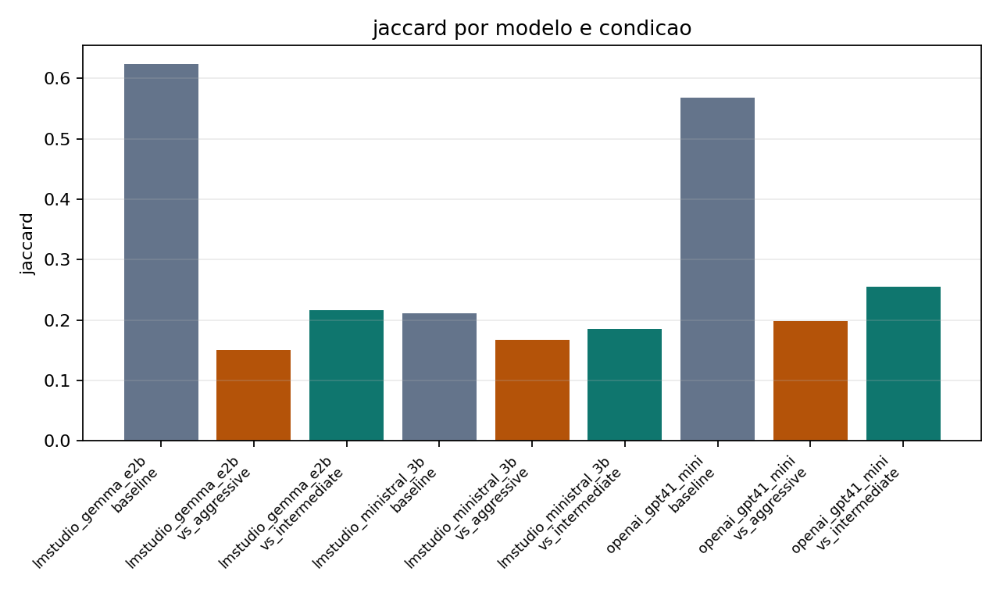

No portugues, o VS reduziu fortemente a sobreposicao lexical em quase todos os modelos. O efeito foi especialmente claro em `gemma-4-e2b-it-mlx` e `gpt-4.1-mini`.

| Modelo | Condicao | Jaccard | Self-BLEU | Distinct-1 | Distinct-2 |
|---|---|---:|---:|---:|---:|
| Gemma | baseline | 0.623 | 0.765 | 0.310 | 0.427 |
| Gemma | VS intermediario | 0.217 | 0.291 | 0.619 | 0.805 |
| Gemma | VS agressivo | 0.150 | 0.198 | 0.686 | 0.894 |
| Ministral | baseline | 0.211 | 0.169 | 0.522 | 0.864 |
| Ministral | VS intermediario | 0.185 | 0.190 | 0.607 | 0.871 |
| Ministral | VS agressivo | 0.168 | 0.148 | 0.631 | 0.903 |
| GPT-4.1 mini | baseline | 0.568 | 0.731 | 0.324 | 0.450 |
| GPT-4.1 mini | VS intermediario | 0.255 | 0.320 | 0.561 | 0.777 |
| GPT-4.1 mini | VS agressivo | 0.198 | 0.239 | 0.613 | 0.848 |

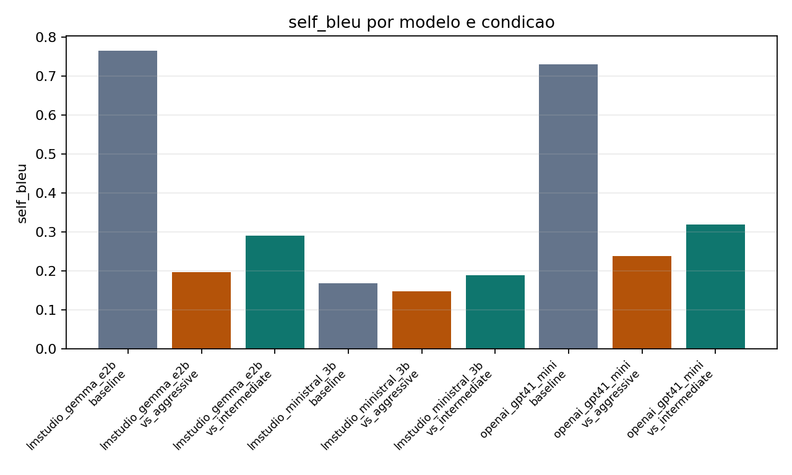

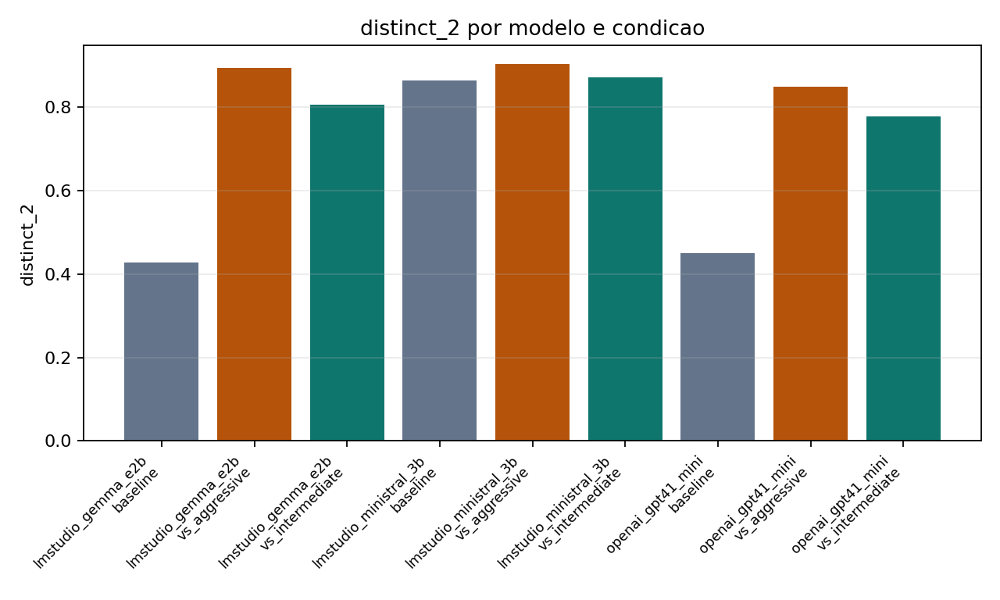

O resultado confirma o objetivo principal do trabalho: quando o modelo e instruido a verbalizar uma distribuicao de respostas, a diversidade aumenta mais do que no prompt direto. No `baseline`, Gemma e GPT tendem a repetir estruturas muito parecidas. Com VS, essas repeticoes caem de forma expressiva.

O Ministral tem um comportamento diferente: seu baseline ja e mais disperso lexicalmente. Isso explica por que o ganho automatico parece menor. Porem, a avaliacao manual mostra que essa diversidade inicial nao significava necessariamente maior qualidade.

### 4.2 Cobertura de Tom e Confiabilidade do Formato

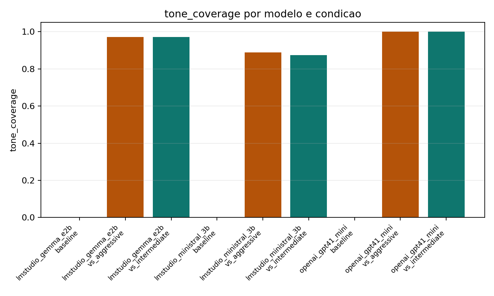

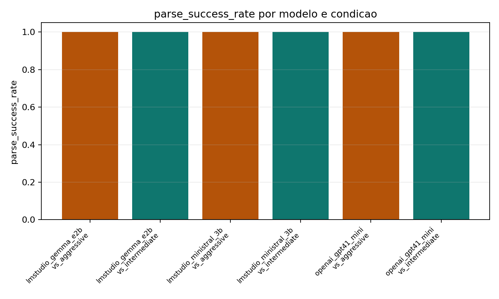

Todas as condicoes VS em portugues tiveram `parse_success_rate = 1.0`. Isso indica que os prompts com JSON estrito e a temperatura menor foram suficientes para manter o pipeline estavel.

A cobertura de tons tambem foi alta:

| Modelo | VS intermediario | VS agressivo |
|---|---:|---:|
| Gemma | 0.972 | 0.972 |
| Ministral | 0.875 | 0.889 |
| GPT-4.1 mini | 1.000 | 1.000 |

O GPT foi o modelo mais consistente na cobertura dos tons esperados. O Ministral ficou abaixo dos demais, mas ainda com valores aceitaveis. A taxa de tons validos tambem foi alta: Gemma e GPT chegaram a 1.0; Ministral ficou em 0.992 no VS intermediario e 0.975 no VS agressivo.

### 4.3 Perplexity

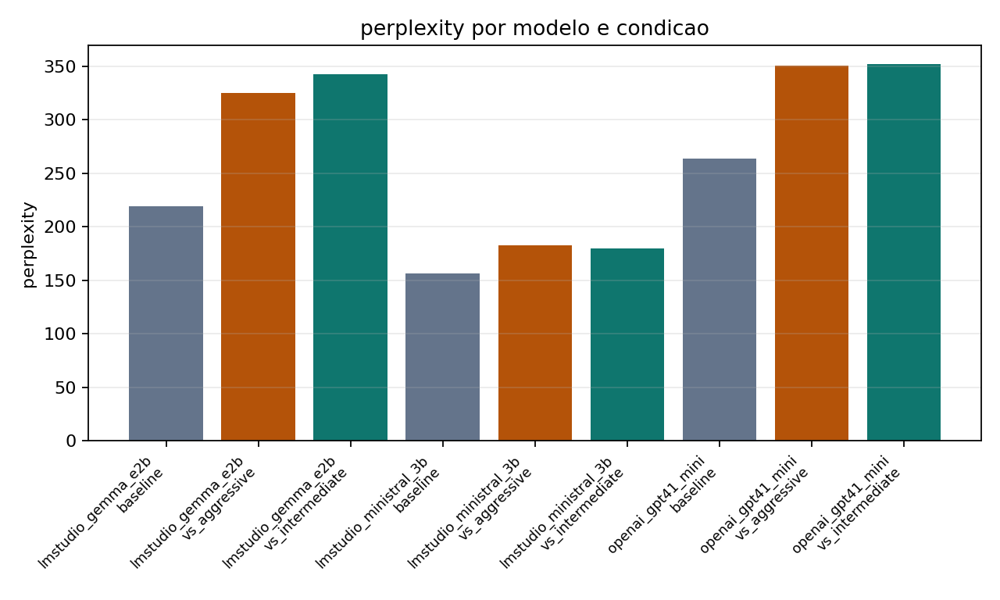

Em portugues, a perplexity aumentou nas condicoes VS em relacao ao baseline. Isso nao invalida o resultado; indica que as respostas VS sao lexicalmente mais variadas e menos proximas dos padroes preferidos pelo modelo avaliador fixo.

| Modelo | Baseline | VS intermediario | VS agressivo |
|---|---:|---:|---:|
| Gemma | 219.091 | 342.687 | 324.847 |
| Ministral | 156.285 | 179.747 | 183.102 |
| GPT-4.1 mini | 263.966 | 351.934 | 350.294 |

Essa metrica deve ser interpretada junto com a avaliacao manual. Uma perplexity maior pode refletir respostas menos padronizadas, nao necessariamente respostas ruins.

### 4.4 Avaliacao Manual

| Modelo | Condicao | Utilidade | Coerencia | Fidelidade | Adequacao ao tom |
|---|---|---:|---:|---:|---:|
| Gemma | baseline | 4.700 | 4.975 | 4.775 | 4.475 |
| Gemma | VS intermediario | 4.542 | 4.992 | 4.575 | 4.375 |
| Gemma | VS agressivo | 4.117 | 5.000 | 4.167 | 4.175 |
| Ministral | baseline | 3.339 | 3.839 | 4.492 | 3.856 |
| Ministral | VS intermediario | 4.308 | 4.867 | 4.475 | 4.133 |
| Ministral | VS agressivo | 4.042 | 4.925 | 4.325 | 3.917 |
| GPT-4.1 mini | baseline | 4.758 | 4.808 | 4.942 | 4.642 |
| GPT-4.1 mini | VS intermediario | 4.800 | 4.992 | 4.858 | 4.417 |
| GPT-4.1 mini | VS agressivo | 4.492 | 4.983 | 4.583 | 4.192 |

A avaliacao manual mostra que o VS intermediario e o melhor compromisso em portugues. Ele aumenta diversidade mantendo notas altas de coerencia, utilidade e fidelidade. O VS agressivo aumenta ainda mais a diversidade, mas reduz utilidade e adequacao ao tom em varios casos.

No baseline do Ministral em portugues, a planilha consolidada registrou 118 avaliacoes validas por metrica; as demais combinacoes tiveram 120. A diferenca e pequena e nao altera o padrao geral observado.

O Ministral e o caso mais interessante: o baseline tem notas manuais mais baixas, mas o VS intermediario melhora bastante utilidade e coerencia. Isso sugere que, para esse modelo, pedir uma distribuicao verbalizada ajuda a organizar melhor as alternativas.

### 4.5 Mensagens Formais vs Informais em Portugues

Agregando os 3 modelos, o VS melhorou a diversidade tanto em mensagens formais quanto informais.

| Formalidade | Condicao | Jaccard | Self-BLEU | Distinct-1 | Distinct-2 |
|---|---|---:|---:|---:|---:|
| formal | baseline | 0.487 | 0.580 | 0.367 | 0.560 |
| formal | VS intermediario | 0.247 | 0.299 | 0.565 | 0.784 |
| formal | VS agressivo | 0.187 | 0.208 | 0.627 | 0.863 |
| informal | baseline | 0.435 | 0.513 | 0.416 | 0.614 |
| informal | VS intermediario | 0.172 | 0.214 | 0.646 | 0.873 |
| informal | VS agressivo | 0.147 | 0.174 | 0.672 | 0.913 |

As mensagens informais tiveram diversidade um pouco maior em todas as condicoes. Isso e esperado, porque mensagens informais permitem mais variacao lexical e estrutural. Ainda assim, o ganho em mensagens formais tambem foi expressivo, o que indica que o VS nao depende apenas de informalidade para gerar alternativas diferentes.

## 5. Resultados em Ingles

### 5.1 Diversidade Lexical

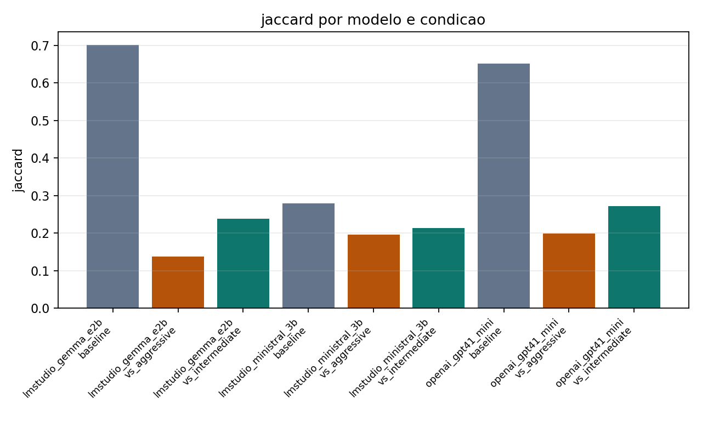

O fluxo em ingles reproduziu o mesmo padrao observado em portugues: o VS reduziu Jaccard e Self-BLEU e aumentou Distinct-1/2.

| Modelo | Condicao | Jaccard | Self-BLEU | Distinct-1 | Distinct-2 |
|---|---|---:|---:|---:|---:|
| Gemma | baseline | 0.701 | 0.838 | 0.268 | 0.359 |
| Gemma | VS intermediario | 0.238 | 0.264 | 0.571 | 0.810 |
| Gemma | VS agressivo | 0.137 | 0.168 | 0.687 | 0.929 |
| Ministral | baseline | 0.279 | 0.295 | 0.458 | 0.780 |
| Ministral | VS intermediario | 0.213 | 0.170 | 0.574 | 0.871 |
| Ministral | VS agressivo | 0.196 | 0.166 | 0.597 | 0.888 |
| GPT-4.1 mini | baseline | 0.652 | 0.822 | 0.274 | 0.390 |
| GPT-4.1 mini | VS intermediario | 0.272 | 0.271 | 0.521 | 0.799 |
| GPT-4.1 mini | VS agressivo | 0.199 | 0.183 | 0.595 | 0.877 |

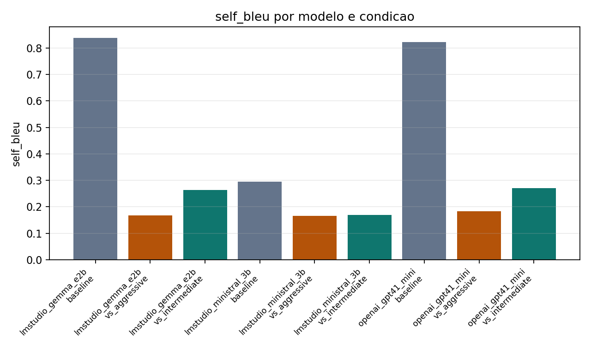

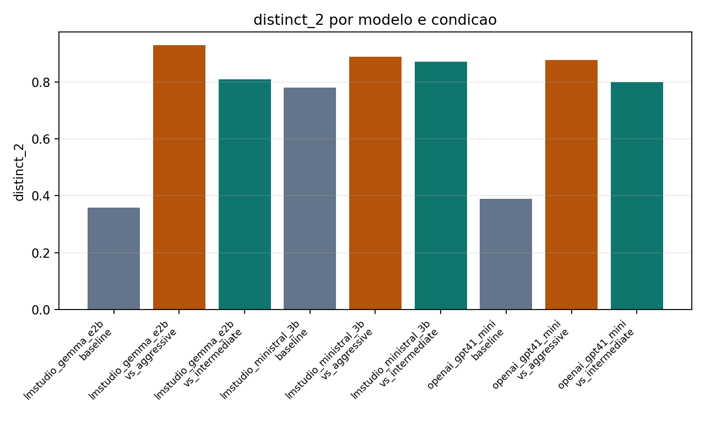

Gemma e GPT tiveram baselines muito repetitivos em ingles, com Jaccard e Self-BLEU altos. O VS reduziu essa repeticao de forma clara. O Ministral novamente apresentou baseline mais diverso, mas com qualidade manual inferior.

### 5.2 Cobertura de Tom e Confiabilidade do Formato

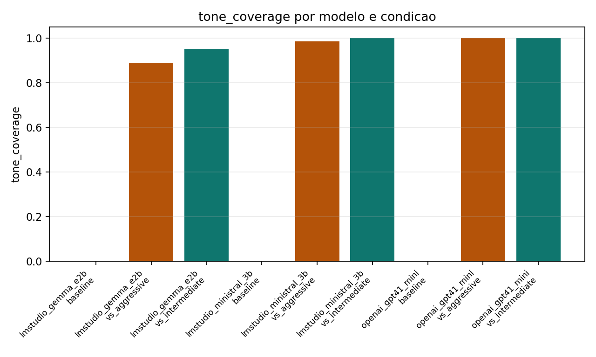


Assim como em portugues, o parse das respostas VS em ingles foi totalmente bem-sucedido (`parse_success_rate = 1.0`) para todos os modelos e condicoes VS.

A cobertura de tons tambem foi alta:

| Modelo | VS intermediario | VS agressivo |
|---|---:|---:|
| Gemma | 0.951 | 0.889 |
| Ministral | 1.000 | 0.986 |
| GPT-4.1 mini | 1.000 | 1.000 |

O resultado em ingles foi especialmente forte para Ministral e GPT. A taxa de tons validos ficou entre 0.950 e 0.975 nos modelos locais e 0.967 no GPT.

### 5.3 Perplexity

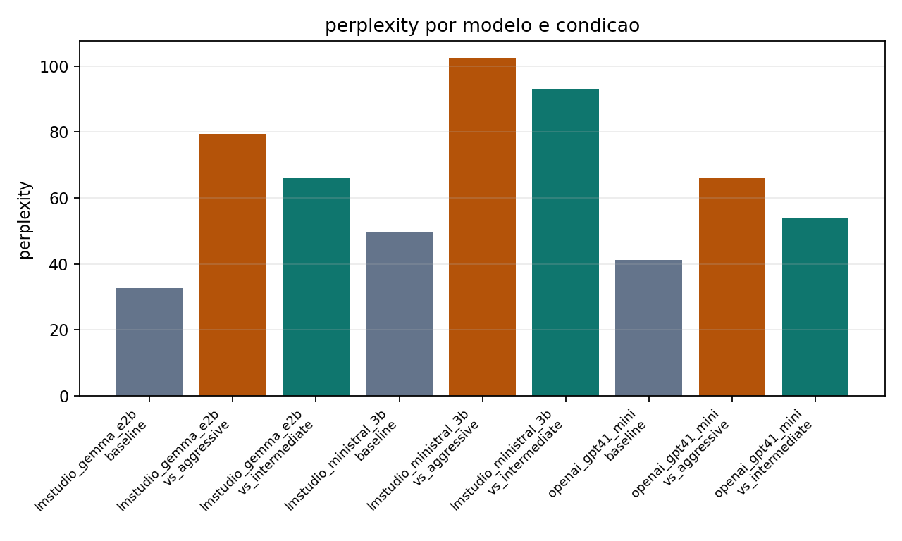

No ingles, a perplexity tambem aumentou nas condicoes VS, principalmente no VS agressivo.

| Modelo | Baseline | VS intermediario | VS agressivo |
|---|---:|---:|---:|
| Gemma | 32.587 | 66.170 | 79.360 |
| Ministral | 49.680 | 92.840 | 102.482 |
| GPT-4.1 mini | 41.153 | 53.892 | 65.967 |

Como o avaliador em ingles e diferente do avaliador em portugues, esses valores nao devem ser comparados diretamente com os valores do fluxo PT. Dentro do ingles, o padrao indica que o VS gera respostas menos padronizadas segundo o avaliador, o que e coerente com maior diversidade lexical.

### 5.4 Avaliacao Manual

| Modelo | Condicao | Utilidade | Coerencia | Fidelidade | Adequacao ao tom |
|---|---|---:|---:|---:|---:|
| Gemma | baseline | 4.933 | 5.000 | 4.900 | 4.642 |
| Gemma | VS intermediario | 4.792 | 5.000 | 4.925 | 4.417 |
| Gemma | VS agressivo | 4.533 | 5.000 | 4.642 | 4.283 |
| Ministral | baseline | 3.683 | 4.217 | 4.300 | 4.342 |
| Ministral | VS intermediario | 4.683 | 5.000 | 4.817 | 4.275 |
| Ministral | VS agressivo | 4.508 | 5.000 | 4.675 | 4.250 |
| GPT-4.1 mini | baseline | 4.933 | 4.958 | 4.975 | 4.875 |
| GPT-4.1 mini | VS intermediario | 4.933 | 5.000 | 4.958 | 4.542 |
| GPT-4.1 mini | VS agressivo | 4.833 | 5.000 | 4.917 | 4.450 |

No ingles, as notas manuais foram ligeiramente mais altas que em portugues. O GPT manteve o melhor nivel geral de qualidade. Gemma tambem teve desempenho muito forte. Ministral novamente teve baseline inferior, mas melhorou substancialmente com VS.

### 5.5 Mensagens Formais vs Informais em Ingles

| Formalidade | Condicao | Jaccard | Self-BLEU | Distinct-1 | Distinct-2 |
|---|---|---:|---:|---:|---:|
| formal | baseline | 0.566 | 0.671 | 0.312 | 0.492 |
| formal | VS intermediario | 0.270 | 0.250 | 0.524 | 0.802 |
| formal | VS agressivo | 0.198 | 0.181 | 0.597 | 0.885 |
| informal | baseline | 0.507 | 0.620 | 0.369 | 0.538 |
| informal | VS intermediario | 0.193 | 0.209 | 0.608 | 0.866 |
| informal | VS agressivo | 0.143 | 0.158 | 0.675 | 0.919 |

O padrao e muito parecido com o portugues. Mensagens informais oferecem mais liberdade de formulacao, mas o VS tambem aumenta claramente a diversidade em mensagens formais.

## 6. Comparacao Critica PT vs EN

### 6.1 O VS Aumentou a Diversidade?

Sim. Em ambos os idiomas, o VS reduziu Jaccard e Self-BLEU e aumentou Distinct-1/2.

O efeito mais forte aparece em Gemma e GPT, cujos baselines sao mais repetitivos. Em portugues, por exemplo, o Jaccard do Gemma cai de 0.623 no baseline para 0.150 no VS agressivo. No ingles, cai de 0.701 para 0.137. No GPT, o padrao tambem e forte: em ingles, Jaccard cai de 0.652 para 0.199.

O Ministral ja apresenta baseline lexicalmente mais variado, mas isso nao significa que ele seja melhor. A avaliacao manual mostra que o baseline do Ministral tem qualidade inferior, especialmente em utilidade e coerencia. Portanto, diversidade automatica isolada nao deve ser confundida com utilidade pratica.

### 6.2 As Respostas Continuaram Adequadas ao Contexto?

Em geral, sim. A avaliacao manual ficou alta nas duas linguas, principalmente no VS intermediario.

Medias manuais agregadas por condicao e idioma:

| Idioma | Condicao | Utilidade | Coerencia | Fidelidade | Adequacao ao tom |
|---|---|---:|---:|---:|---:|
| PT | baseline | 4.266 | 4.541 | 4.736 | 4.324 |
| PT | VS intermediario | 4.550 | 4.950 | 4.636 | 4.308 |
| PT | VS agressivo | 4.217 | 4.969 | 4.358 | 4.094 |
| EN | baseline | 4.517 | 4.725 | 4.725 | 4.619 |
| EN | VS intermediario | 4.803 | 5.000 | 4.900 | 4.411 |
| EN | VS agressivo | 4.625 | 5.000 | 4.744 | 4.328 |

O VS intermediario melhora a utilidade media nos dois idiomas. O VS agressivo ainda preserva coerencia alta, mas reduz fidelidade e adequacao ao tom. Isso sugere que explorar a cauda da distribuicao produz alternativas mais interessantes, mas tambem aumenta o risco de sair do caminho mais adequado.

### 6.3 As Alternativas Foram Uteis ou Apenas Variacoes Superficiais?

As metricas e exemplos indicam que houve diversidade real, nao apenas sinonimos. Os prompts VS pediam explicitamente variacao de tom, estrutura, nivel de detalhe e estrategia comunicativa. Isso aparece na cobertura de tons e na reducao simultanea de Jaccard e Self-BLEU.

Exemplo em portugues para `pt_msg_001`:

| Condicao | Tom | Probabilidade | Resposta |
|---|---|---:|---|
| baseline | - | - | Claro, posso revisar seu texto ate amanha de manha. Por favor, envie o arquivo quando estiver pronto para que eu possa comecar a analise e garantir que o tom esteja adequado. |
| VS intermediario | formal | 0.35 | Claro, posso revisar seu texto ate amanha de manha. Envie-me a versao curta para que eu possa garantir que o tom esteja adequado antes do envio. |
| VS intermediario | cordial | 0.25 | Ficarei feliz em ajudar com a revisao do seu texto ate amanha de manha. Por favor, encaminhe a versao curta para que eu possa verificar o tom e sugerir melhorias, se necessario. |
| VS agressivo | formal | 0.08 | Posso analisar seu texto ate amanha pela manha para assegurar que o tom esteja apropriado antes do envio. |

Exemplo em ingles para `en_msg_001`:

| Condicao | Tom | Probabilidade | Resposta |
|---|---|---:|---|
| baseline | - | - | Certainly, I will review your text and provide feedback by tomorrow morning to ensure the tone is appropriate. Please send it over at your earliest convenience. |
| VS intermediario | formal | 0.35 | Certainly, I will review your text and provide feedback on the tone by tomorrow morning as requested. |
| VS intermediario | cordial | 0.25 | I'd be happy to review your text and ensure the tone is appropriate. You can expect my feedback by tomorrow morning. |
| VS agressivo | formal | 0.08 | I will allocate time to review your text by tomorrow morning and ensure the tone aligns with your intent. |

Esses exemplos mostram variacao de tom e formulacao. Ainda assim, algumas alternativas agressivas se aproximam de respostas menos naturais ou menos uteis. Isso confirma que o VS agressivo deve ser tratado como ferramenta exploratoria, nao como melhor configuracao geral.

### 6.4 Em Quais Tipos de Mensagem o VS Ajudou Mais?

Em portugues, as maiores reducoes de Jaccard no VS agressivo ocorreram em:

| Categoria | Queda de Jaccard | Ganho de Distinct-2 | Queda de Self-BLEU |
|---|---:|---:|---:|
| confirmacao | 0.364 | 0.315 | 0.388 |
| recusa | 0.346 | 0.327 | 0.354 |
| agradecimento | 0.323 | 0.347 | 0.408 |
| pedido | 0.299 | 0.310 | 0.400 |

Em ingles, as maiores reducoes de Jaccard ocorreram em:

| Categoria | Queda de Jaccard | Ganho de Distinct-2 | Queda de Self-BLEU |
|---|---:|---:|---:|
| gratitude | 0.447 | 0.428 | 0.513 |
| refusal | 0.408 | 0.396 | 0.446 |
| request | 0.407 | 0.404 | 0.513 |
| invitation | 0.384 | 0.431 | 0.555 |

O VS parece mais vantajoso quando a mensagem permite diferentes estrategias comunicativas: recusar com cuidado, agradecer com diferentes graus de calor, fazer um pedido com mais ou menos formalidade, ou confirmar algo de forma objetiva ou cordial.

### 6.5 Comparacao entre Modelos

O `gpt-4.1-mini` foi o modelo mais estavel e consistente. Ele teve alta cobertura de tom, parsing perfeito e notas manuais fortes nos dois idiomas. Isso confirma a utilidade de incluir um modelo fechado como referencia.

O `gemma-4-e2b-it-mlx` foi o melhor representante local. Ele apresentou forte ganho de diversidade com VS e manteve boa qualidade manual. Em varios casos, seu baseline era repetitivo, mas o VS conseguiu extrair alternativas mais variadas.

O `ministral-3-3b-instruct-2512` teve comportamento mais irregular. Seus baselines eram lexicalmente diversos, mas manualmente mais fracos. Com VS, especialmente no intermediario, o modelo melhorou bastante em utilidade e coerencia. Isso sugere que o prompt estruturado ajudou o modelo a produzir respostas mais organizadas.

## 7. Reprodutibilidade

A execucao final em portugues foi registrada em:

```text
results/final/lmstudio_pt_final/
```

A execucao final em ingles foi registrada em:

```text
results/final/lmstudio_en_final/
```

Cada pasta final contem:

```text
manifest.json
generations.jsonl
metrics_long.csv
metrics_summary.csv
manual_eval_template.csv
manual_eval_filled.csv
manual_metrics_summary.csv
response_examples.csv
figures/
```

Os manifests registram:

- `run_id`;
- horario de inicio e fim;
- hash do dataset;
- modelos usados;
- parametros de geracao;
- prompts usados;
- ambiente Python;
- versoes de dependencias;
- arquivos gerados.

As duas execucoes finais foram:

| Run | Dataset | Inicio UTC | Fim UTC | Duracao aproximada |
|---|---|---:|---:|---:|
| `lmstudio_pt_final` | `messages.jsonl` | 04:33:20 | 04:52:59 | 19min39s |
| `lmstudio_en_final` | `messages_en.jsonl` | 05:05:01 | 05:23:06 | 18min05s |

Comandos principais para reproducao:

```bash
python3 scripts/validate_project.py --config configs/experiment.lmstudio.yaml
python3 scripts/check_lmstudio.py --config configs/experiment.lmstudio.yaml

.venv/bin/python scripts/run_experiment.py \
  --config configs/experiment.lmstudio.yaml \
  --run-id lmstudio_pt_final

.venv/bin/python scripts/compute_metrics.py \
  --config configs/experiment.lmstudio.yaml \
  --run-id lmstudio_pt_final

python3 scripts/make_plots.py --run-id lmstudio_pt_final
python3 scripts/export_manual_eval.py --run-id lmstudio_pt_final
```

Para o fluxo em ingles:

```bash
python3 scripts/validate_project.py --config configs/experiment.lmstudio.en.yaml
python3 scripts/check_lmstudio.py --config configs/experiment.lmstudio.en.yaml

.venv/bin/python scripts/run_experiment.py \
  --config configs/experiment.lmstudio.en.yaml \
  --run-id lmstudio_en_final

.venv/bin/python scripts/compute_metrics.py \
  --config configs/experiment.lmstudio.en.yaml \
  --run-id lmstudio_en_final

python3 scripts/make_plots.py --run-id lmstudio_en_final
python3 scripts/export_manual_eval.py --run-id lmstudio_en_final
```

Para executar o modelo OpenAI, e necessario definir `OPENAI_API_KEY`. Para os modelos locais, e necessario iniciar o servidor local do LM Studio em `http://localhost:1234/v1` com Gemma e Ministral disponiveis.

## 8. Limitacoes

Algumas limitacoes devem ser consideradas:

- A avaliacao manual foi consolidada por planilha, mas nao houve medicao de concordancia entre multiplos avaliadores.
- A perplexity usa avaliadores diferentes por idioma, entao nao serve para comparar portugues contra ingles em valor absoluto.
- Os modelos locais dependem do LM Studio, da versao baixada dos modelos e do ambiente Apple Silicon usado na execucao.
- O VS agressivo usa probabilidades verbalizadas pelo proprio modelo; essas probabilidades sao metadados aproximados, nao estimativas calibradas.
- Runs antigas com Qwen, Phi, smoke tests e depuracoes foram descartadas da analise final por nao representarem o fluxo final reprodutivel.
- O grafico `diversity_overview.png` nao foi usado na discussao porque mistura metricas com direcoes diferentes, o que pode gerar interpretacao agregada pouco confiavel.

## 9. Conclusao

Os resultados indicam que o Verbalized Sampling cumpriu o objetivo principal do trabalho: aumentar a diversidade das respostas em comparacao ao baseline direto. Isso ocorreu nos dois idiomas, nos tres modelos e nas principais metricas automaticas de diversidade.

O ganho mais forte aparece no VS agressivo, mas a avaliacao manual mostra que ele tambem aumenta o risco de perda de utilidade, fidelidade e adequacao ao tom. Por isso, a melhor configuracao geral e o VS intermediario: ele aumenta diversidade de forma consistente sem degradar substancialmente a qualidade das respostas.

A comparacao entre modelos mostra que o `gpt-4.1-mini` foi o mais estavel, o Gemma foi um modelo local competitivo e o Ministral se beneficiou bastante do prompt estruturado de VS. A comparacao PT/EN mostrou padroes semelhantes, reforcando que o pipeline e independente do idioma desde que dataset, prompts, tons e modelo de perplexity sejam configurados adequadamente.

Em sintese, o VS nao e apenas uma forma de "gerar varias respostas". Quando implementado como distribuicao verbalizada com tons e probabilidades, ele oferece uma estrategia pratica para explorar alternativas mais variadas e ainda uteis em um assistente de escrita.
